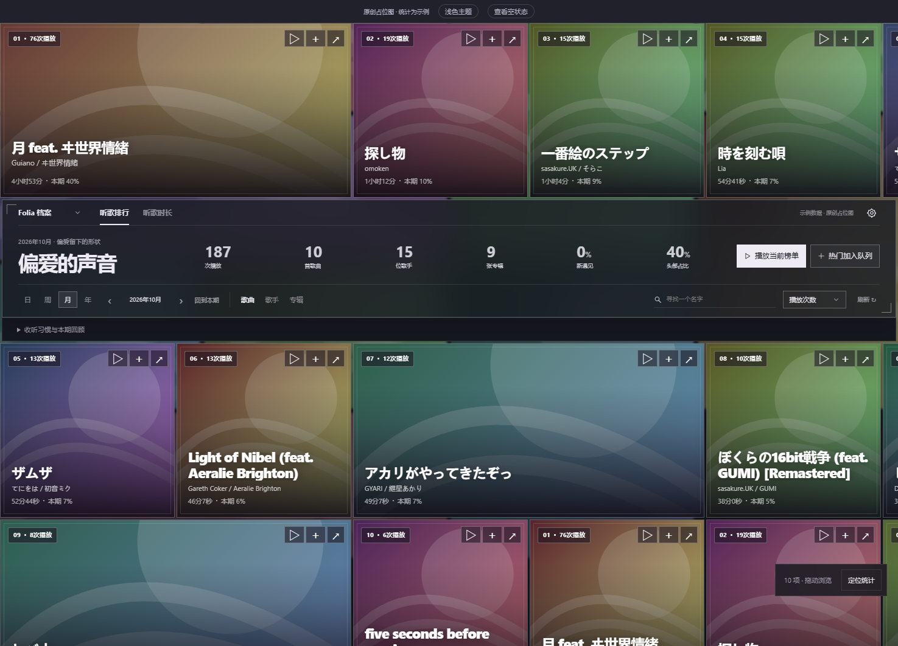
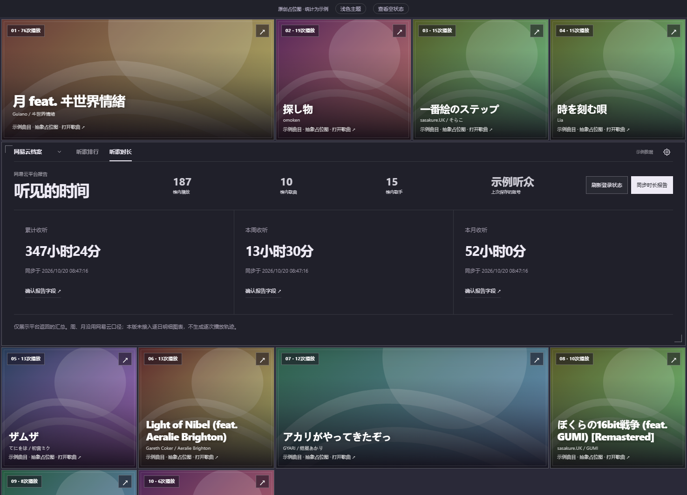

# 听歌档案 · Folium 模组

记录 Folia 本机播放，并在同一页面切换查看网易云云端听歌档案。封面窗格围绕中央亚克力横幅排列。Folia 档案支持歌曲／歌手／专辑榜单，以及声河、热力图、折线图三套时长视图；网易云展示平台榜单与汇总报告。

适配并实际加载验证：Windows 上的 Folia 0.7.21、Folium 1.6。其他系统和后续 Folia 版本尚未实测。

当前版本 1.2.3：打包目录 `dist/listening-archive` 随源码入库，用于 folium-compound 模组市场按子目录收录；安装包不再包含仓库截图。此前 1.2.2：新增模组介绍图，manifest 声明 `preview.jpg`，构建和安装包同步携带。此前 1.2.1：亚克力横幅随横向画布持续延伸，移除右下角常驻提示；README 改用真实歌曲封面。此前 1.2.0：排行改为可无限拖动、聚焦的封面画布；从榜单播放会替换整条队列，收起统计横幅后进入 Folia 原生队列拼贴。网易云展示完整返回榜单（实测周榜、总榜均为 100 首），沿用现有登录。修复封面交接、来源菜单越界、报告保存按钮遮挡和周期切换日期漂移。

源码与问题反馈：[GitHub 仓库](https://github.com/imicola/folia-listening-archive) · 安装包：[Releases](https://github.com/imicola/folia-listening-archive/releases/tag/v1.2.3)

## 界面预览


模组介绍图为 1280 × 720 JPG，小于 1 MB；使用对应的真实歌曲封面及合成统计。

截图使用真实歌曲及其对应专辑封面，搭配合成听歌数据和示例账号，不含真实账号资料。[查看全部 7 张截图](docs/screenshots/README.md)。





## 安装

1. 在 Folia 的「设置 → 模组」开启模组系统。
2. 安装 `listening-archive-v1.2.3.zip`。若界面没有安装 ZIP 的入口，点击「打开模组目录」，将 ZIP 中的 `listening-archive` 文件夹完整解压到该目录，再点击「重载」。
3. 启用「听歌档案」，阅读 Folia 显示的权限说明并确认。首页会出现「听歌档案」入口，也可在命令台查找「打开听歌档案」。

更新时替换模组目录中的程序文件，再重载、重新启用；若仍显示旧界面，退出并重启 Folia。统计数据保存在独立目录，更新包不携带你的记录。

## 网易云档案

1. 先在 **Folia 首页**连接并登录网易云。这里复用的是 Folia 的网易云会话，不读取网易云官方客户端的登录文件。
2. 在横幅左侧「Folia 档案」菜单切换到「网易云档案」。已有本机页面的周期、搜索与视图状态会保留。
3. 点「同步当前榜单」，取得最近一周或所有时间榜单。歌曲封面与同一歌曲 ID 的资料对应。歌手／专辑是本次取得榜单内的歌曲贡献，不是全量平台统计；合唱分别归属各位歌手。
4. 进入「听歌时长」，点击「同步时长报告」，分别请求累计、本周、本月报告。平台拒绝、需要会员或没有数据时会显示原因；失败保留上次快照及时间。
5. **已用真实账号核实周／月报字段为分钟，并按平台实际周期展示。累计字段 `data.totalDuration` 已由本次账号的网易云原生显示对照确认为秒；首次使用可在设置中选择该字段和秒单位保存。** 未识别报告不会猜测数字含义：点「确认报告字段」，在设置中根据平台显示选择实际时长字段和秒／分钟／毫秒单位，再保存。未识别字段保持未知，不显示成 0，也不用歌曲长度乘次数代替。

云端时长展示网易云汇总，尚未将平台逐日数据接入云端图表，也不生成平台逐次播放轨迹。点击封面聚焦；点击「▷」将当前筛选榜单作为新队列，从所选歌曲开始在 Folia 中播放并进入原生拼贴。这些实际播放会继续积累到 Folia 本机档案。

**兼容性：** Folium 1.6 没有正式公开登录接口。本版集中在 `src/client/netease-host.ts` 兼容 Folia 0.7.21 的 `window.electron.getNeteasePort()` 与现有会话键。每次请求重新读取内置服务端口，账号切换或插件卸载后丢弃旧响应。凭据只用于本机内置服务请求，不经插件 RPC、不写插件磁盘文件，不复制或修改 Folia 的登录信息。后续宿主改变内部实现时可能需要适配。

网易云快照保存在模组数据目录下的 `netease/`，与 Folia 原始播放记录分离；现有本机备份按钮只备份 Folia 播放记录，不包含网易云快照。切换账号时清空内存中的旧账号状态，新的同步结果覆盖当前快照，不合并账号；此前落盘的原始报告可能保留至下一次对应报告同步。共享设备如需清除旧数据，请退出 Folia 后删除专属数据目录下的 netease 文件夹。

## Folia 本机档案使用

- **听歌排行**：拖动或滚轮浏览重复铺排的无限画布，歌曲只在队列中出现一次。点击封面放大聚焦，Escape 收起；画布获得焦点后按 Home 回到统计横幅。支持歌曲／歌手／专辑、排序和搜索。
- **整队播放**：「▷」和「播放当前榜单」以当前筛选榜单覆盖原队列，从所选歌曲开始，收起横幅并进入 Folia 原生拼贴；「＋」和「热门加入队列」仍是明确的追加操作。
- **日期锚点**：切换日／周／月／年时回到当前日期对应周期，上一／下一周期用于浏览历史。
- **听歌时长**：选择日／周／月／年，在声河、热力图、折线图之间切换。点击时间位置查看对应记录。声河以真实小时／日／月汇总形成光带，空白时间保持空白。
- **单曲轨迹**：首次被记录、累计次数和时长、最近 24 个月的榜单位置、星期与小时分布、按日期筛选的播放时间轴。
- **时段探索**：点击“星期 × 小时”格点，查看该时段的歌曲与记录。
- **设置与备份**：右上角齿轮可开启低性能模式、导出或合并备份。系统“减少动态”偏好也会生效。

排行榜只在打开页面、切换统计条件或主动刷新时更新，浏览期间不会自行重排。统计页关闭时仍持续采集。

## 封面和播放的接口边界

Folia 当前公开的歌曲记录不直接包含封面。模组在**打开播放页、公开接口可读取封面时**缩小并缓存在本机；也可以在单曲轨迹中补充本地图片。尚未取得封面的歌曲会明确显示缺少封面。

历史档案不保存跨启动失效的临时播放句柄。整队播放优先复用当前队列对象；网易云歌曲按原始平台 ID 还原，本地歌曲只读查询 Folia 曲库并要求唯一匹配。无法解析的项会提示并跳过；选中的歌曲不可用时保持原队列。已缓存封面随歌曲交给拼贴，尚无封面资料的歌曲仍可能显示宿主占位背景。

**队列兼容边界：** Folium 1.6 没有整队替换接口，因此 `src/client/native-queue.ts` 适配 Folia 0.7.21 的模块指纹，使用宿主队列状态及公开 `playQueueItem`，通过宿主原有导航进入拼贴。不会修改宿主文件。不同构建会在改动队列前报错；不要把版本范围视为其他构建已验证。动效按官方画布的拖动阈值、惯性、聚焦回流与横幅收起方式独立实现。

## 统计口径

- 实际听满 `min(30 秒, 歌曲时长的一半)` 计一次；未知时长按 30 秒门槛计次。快速略过仍保留已观测片段。
- 实际累计达到歌曲时长的 90%，按整首时长统计；提前切歌记实际片段。未知时长不推算整首。
- 暂停、拖动、长采样空档和睡眠时间不会补成听歌时长。静音播放仍记录。排除视频导出、仅展示外部歌词的场景。混音的数秒重叠不做精密计量。
- 歌曲按规范化的歌名＋歌手归并，忽略大小写、多余空格与歌手排列顺序；保留 Live 等标题标记。原始来源与专辑不变。
- 合唱分别归属每位歌手；专辑按专辑名＋主要歌手归组，每次播放保留当时专辑归属。
- 采用设备本地时间，周一为一周起点。跨午夜片段拆分；完播补足按实际片段比例分配。一次有效播放归入该次记录的开始时刻。
- “新遇见”指本期首次被**此模组**记录的歌曲占比。“头部占比”为时长最多的单曲占比，不是综合评分。

从模组启用后开始积累；不回填之前的个人听歌历史。

## 数据与备份

记录位于 Folia 用户数据下 `mods-data/listening-archive/files/`：按月的 `YYYY-MM.jsonl`、`checkpoints.json`、`settings.json` 和 `artwork/`。主进程是唯一写入者，约每 5 秒保存检查点，切歌及时结算；异常退出后恢复最后一个成功检查点。

设置中的导出将**原始听歌记录**写入「文档/Folia 听歌档案备份」。导入只补充未知记录 ID，重复导入不增加次数。单个备份导入上限 50 MiB、10 万条；封面缓存与设置不包含在记录备份中。迁移完整档案时可在退出 Folia 后一并复制专属数据目录。

权限：`filesystem.data` 用于专属本地数据目录，`stageLayers` 用于通过公开播放页接口缓存封面，`playback.control` 用于你点击后的播放／队列操作。整队播放还会只读查询宿主 IndexedDB 本地曲库，不添加文件权限或修改曲库。网易云功能会向 Folia 内置的本机回环服务发起请求，图片按音乐来源的 URL 加载。不向开发者发送统计或账号数据，无额外遥测服务。

## 源码与本地预览

安装依赖后运行：

```text
npm ci
npm run typecheck
npm test
npm run build
npm run test:package
npm run preview
```

预览地址 `http://127.0.0.1:4326`，仅绑定本机。预览中的听歌记录为合成示例，图像为与曲目对应的真实专辑封面，来源见 src/preview/assets/covers.json；预览操作不控制真实 Folia，也不连接真实账号。Windows 上运行 `npm run package` 生成安装 ZIP。

安装包自带界面依赖，不需要用户另装 Node。实测范围见 [VALIDATION.md](VALIDATION.md)，提交模组时可参考 [docs/SUBMISSION.md](docs/SUBMISSION.md)。
