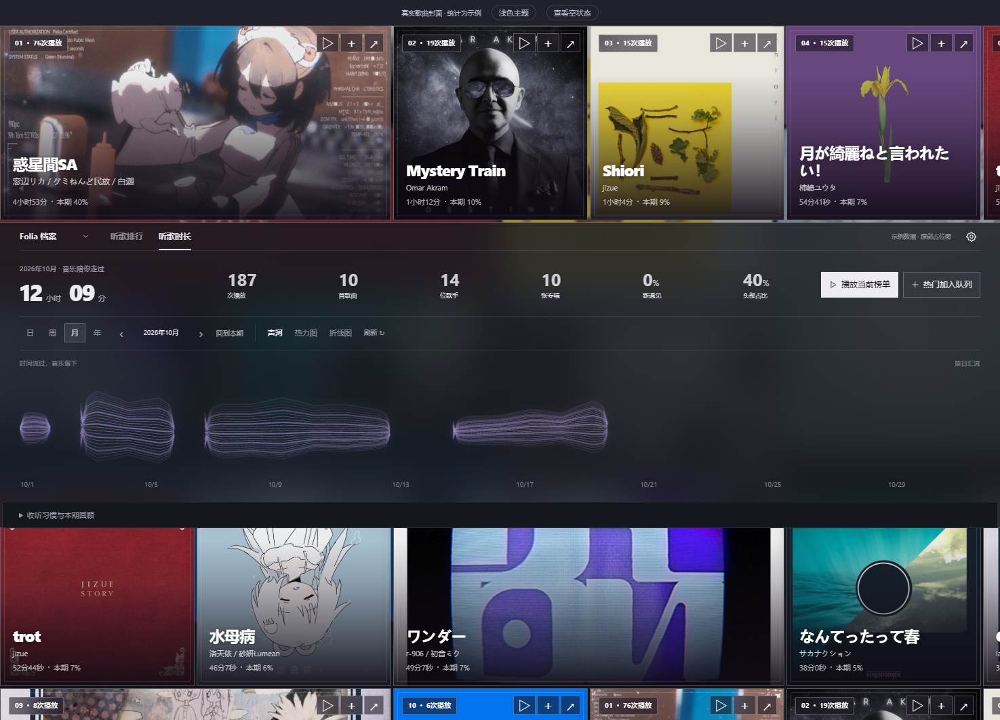
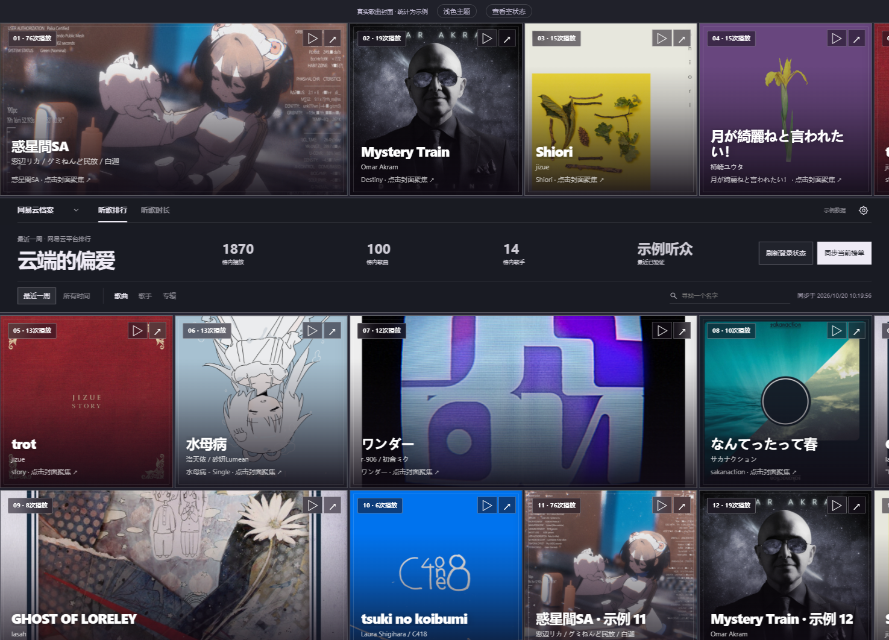
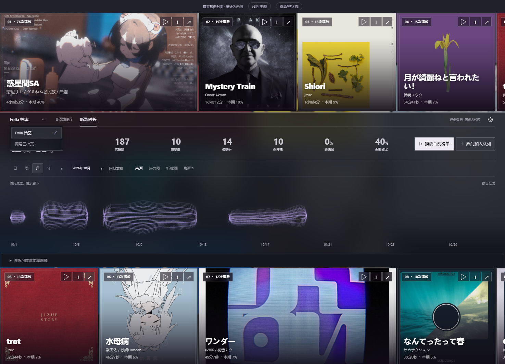
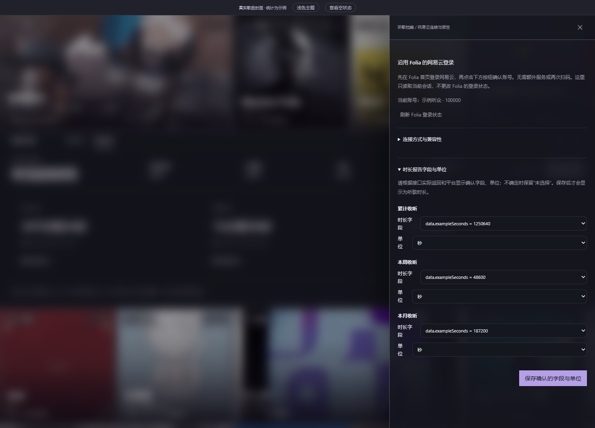
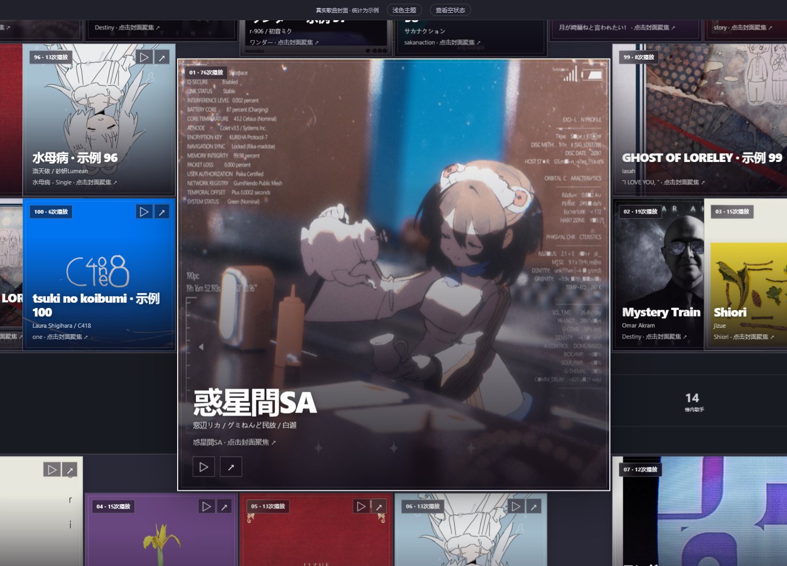

# 示例截图

这些截图使用隔离浏览器预览中的**合成听歌记录、示例账号和真实歌曲封面**。不连接真实 Folia 或网易云账号，不包含个人听歌记录；封面与曲目对应，来源见 [封面索引](../../src/preview/assets/covers.json)。封面版权归相应权利人，作为模组界面演示素材，不属于 MIT 授权范围。

版本：1.2.1；视口：1475 × 1062；拍摄日期：2026-10-20。

## Folia 本机排行

## Folia 本机时长

## 网易云排行

## 网易云时长

## 来源菜单

菜单向页面内部展开，左边缘保持在档案区域内。

## 报告字段设置

保存按钮位于设置面板右侧。字段和值均为示例；真实使用时以实际报告为准。

## 画布聚焦

